  

  
  
  
  

# MARINT Baltic

**MARINT Baltic** is a maritime intelligence console that watches the undersea cables and pipelines of the Gulf of Finland using **live ship positions and real NASA satellite data**. It flags vessels that behave suspiciously above critical infrastructure and explains, in plain language, why each one was flagged.

This project was built for the **2026 NASA Space Apps Challenge** ("The Next Frontier"), in response to the challenge **Dancing with the SARs**, which asks teams to turn satellite radar (SAR) data into an interactive application that tracks and visualises change. Our change of interest is at sea: ships appearing, stopping and going dark above critical infrastructure.

## The story: from the Caspian to the Baltic

MARINT started as a concept for the Caspian Sea. The [first MARINT prototype](https://marint.vercel.app/operations) showed what a dark-vessel detection console could look like, but it ran on simulated data.

MARINT Baltic is the continuation of that project, with the same design, logo and workflow, and one big difference: **nothing is simulated**. Every vessel, satellite image and sanctions record on screen comes from a live public source.

We moved to the Baltic Sea for two reasons:

- **The need is real.** Since 2023, cables and pipelines in the Gulf of Finland have been damaged several times by ships dragging their anchors, including the Balticconnector gas pipeline and the EstLink 2 power cable.
- **The data is open.** The Baltic is one of the few seas where live AIS, satellite radar, infrastructure maps and sanctions lists are all freely available without an API key.

## Try it

Open **https://marint-baltic.vercel.app/** or scan the QR code.

To run it locally, download `index.html` and open it in a browser. The whole app is a single file with no build step, no server and no keys.

 

## What it does

| Feature | What you see |
|---|---|
| **Live traffic** | Every AIS-transmitting vessel in the Gulf of Finland, refreshed each minute |
| **Infrastructure watch** | Corridors around pipelines and cables; vessels inside them are scored for risk |
| **Explainable alerts** | A 0–100 score built from visible rules, each one listed with its weight |
| **NASA radar** | Sentinel-1 radar imagery from NASA, with in-browser ship detection matched against AIS to find vessels that are not transmitting |
| **Sanctions highlight** | Vessels on sanctions and shadow-fleet lists are marked in a separate colour |
| **Vessel panel** | Real ship photo, speed, course, status, flag, track history and events |
| **Investigation page** | Evidence timeline, satellite image chips, assessment and next steps for one vessel |
| **Report** | A printable incident report generated from the investigation |
| **Cases and timeline** | Save a situation as a case file and replay it later, for example in a pitch |
| **Co-Pilot** | Ask questions about the selected vessel and get answers drawn from the data on screen |

## Data sources

All sources are public and need no API key.

| Source | Used for |
|---|---|
| **NASA GIBS** — OPERA RTC-S1 (Sentinel-1 SAR) | Radar imagery and ship detection |
| **NASA GIBS** — VIIRS true colour and Day/Night Band, HLS | Optical and night-time imagery |
| **NASA CMR** | Exact times of each radar pass |
| **Fintraffic Digitraffic** | Live AIS positions and vessel details |
| **EMODnet** | Pipeline routes |
| **OpenSanctions** (maritime dataset) | Sanctioned and shadow-fleet vessels |
| **Open-Meteo** | Wind conditions |
| **Wikimedia Commons** | Ship photographs, matched by IMO number |
| **Natural Earth** | Coastline base map |

## How an alert is scored

MARINT uses transparent rules instead of a black-box model, so an operator can always see why a vessel was flagged. The main signals are:

- stopped or anchored inside an infrastructure corridor
- the anchor-drag signature: a sharp drop in speed while the heading and the course over ground disagree
- a gap in AIS transmission
- a long dwell time above a cable or pipeline
- vessel type, and presence on a sanctions list or the user's watchlist

Strong wind lowers the score, because ships slow down in bad weather for innocent reasons. Ferries, tugs, pilot boats and other service craft are excluded.

## Honest limitations

- Routes of some power and telecom cables are approximate, because exact coordinates are not published. These are marked in the app and scored more cautiously.
- Track history is collected in the browser, so it only covers the time the page has been open, unless a saved case is loaded.
- Radar passes over the Gulf of Finland are near-daily, not continuous.
- The Co-Pilot is rule-based. It is not a language model.

## Built with

Plain HTML, CSS and JavaScript in one file, with [MapLibre GL](https://maplibre.org/) for the map. Hosted on Vercel.

## Team

**Team MARINT**, Baku, Azerbaijan.

## Credits and licences

- Satellite imagery courtesy of NASA EOSDIS GIBS and the OPERA project; contains modified Copernicus Sentinel data.
- AIS data: Fintraffic / digitraffic.fi, CC BY 4.0.
- Sanctions data: OpenSanctions, CC BY-NC 4.0 (non-commercial use).
- Pipeline routes: EMODnet Human Activities.
- Ship photographs: Wikimedia Commons, each credited to its author in the app.
- Base map: Natural Earth, public domain.

This is a hackathon prototype for research and demonstration. It is not a navigation or law-enforcement tool, and an alert is a prompt for human review, not proof of wrongdoing.
